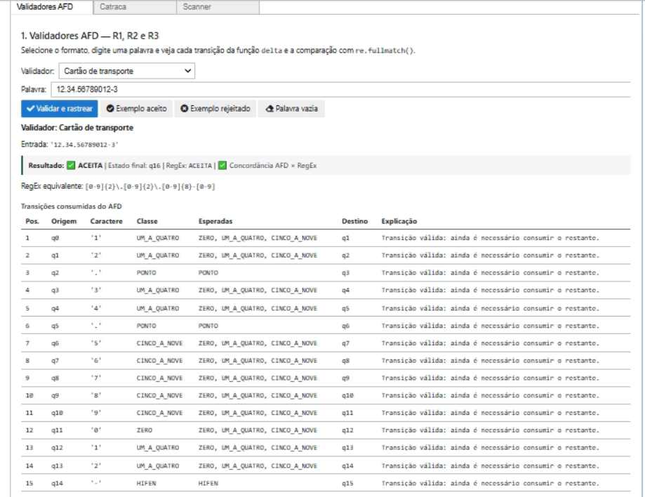
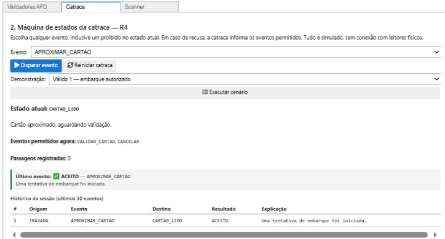
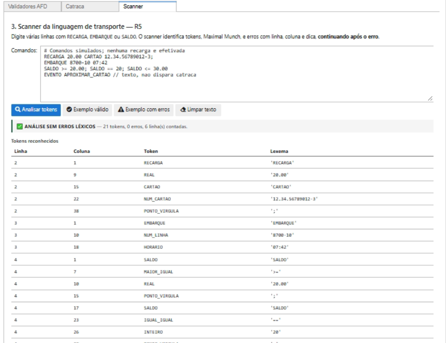

# Cartão de Transporte 🚍

**Do cartão à catraca: um estudo de autômatos**  
Prática 3 — Python e Jupyter Notebook

## Integrantes

| Nome | RA |
|---|---|
| Bruno dos Reis Ferreira Santos | 2564952 |
| Vinicius de Freitas Ferreira | 2373516 |
| Matheus Francisco | 2693112 |
| Matheus de Oliveira | 2369955 |

## Sobre o projeto

Escolhemos o transporte público para colocar em prática o que aprendemos sobre autômatos e análise de textos. Fizemos validadores de cartão e de linha de ônibus, uma catraca simulada e um scanner de comandos. Os códigos e os embarques são exemplos fictícios.

O projeto funciona em um painel com três abas, feito no Jupyter Notebook.

### 1. Validador



Podemos digitar o número de um cartão ou de uma linha e ver se está no formato correto. O programa mostra por quais estados a entrada passou e se foi aceita ou rejeitada.

### 2. Catraca



Simulamos os eventos de um embarque, como aproximar e validar o cartão. A catraca muda de estado conforme os eventos e avisa quando uma ação é feita fora da ordem.

### 3. Scanner



O scanner lê comandos de exemplo e separa as partes do texto (tokens). Também informa linha, coluna e dá uma dica quando encontra um erro.

## Como executar

É preciso ter **Python 3.10 ou superior** instalado. No Windows, abra o terminal dentro da pasta do projeto e execute:

```cmd
python -m venv .venv
.\.venv\Scripts\python.exe -m pip install -r requirements.txt
.\.venv\Scripts\python.exe -m notebook Inicio.ipynb
```

No Jupyter, clique em **Run → Run All Cells** e experimente as três abas. Depois de instalar as dependências, também é possível abrir pelo arquivo `INICIAR.cmd`.

O arquivo **[Inicio.ipynb](Inicio.ipynb)** abre o painel. O **[notebook de exemplos](notebooks/Cartao_Transporte.ipynb)** mostra os autômatos, os diagramas, as tabelas e os testes de entradas.

Os desenhos dos autômatos ficam na pasta [`diagramas`](diagramas/). O código Python fica em `src` e os testes ficam em `tests`.


